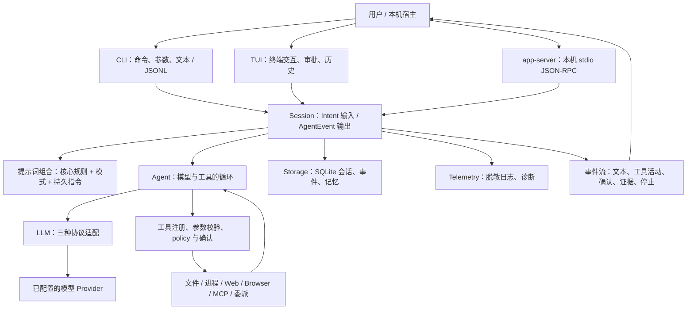

# Rivo 新用户导读：架构、能力与使用场景

> 阅读目标：先理解 Rivo 能帮你做什么，再理解它如何工作，最后按需进入配置指南或源代码。
>
> 本文描述仓库当前实现的能力与边界。构建通过不等于所有平台和外部 Provider 都已经完成验收；请根据具体版本的 GitHub Release 说明判断可用范围。

阅读路线：只想了解用途，先读第 1–3 节与第 9 节；想理解架构，再读第 4–8 节；能力状态和源码导航分别在第 10、11 节。

本仓库聚焦本地 CLI、TUI、app-server 和受信任的 A2A 接入；远程 Web、移动端和托管服务属于独立产品界面。

需要把 Rivo 作为其他产品的执行基座，请看 [Desktop App 与 Remote Agent Node 接入说明](runtime-integration.md)，其中分别说明本机嵌入、远程宿主适配和 A2A 节点的机制、流程与能力差异。

## 1. 一句话认识 Rivo

**Rivo 是运行在本机、由大模型驱动、在权限边界内执行任务的通用 Agent。**

普通聊天主要返回文字；Rivo 还可以读取资料、调用工具、观察结果、继续推理，并把过程、证据和会话保存下来。它的价值不是“再提供一个聊天窗口”，而是把自然语言任务转成**可观察、可确认、可追溯的工作过程**。

- 对使用者：通过命令行 CLI 或终端交互界面 TUI 提交任务、查看过程、批准或拒绝操作。
- 对开发者：CLI/TUI 共用 Session 与 Agent 内核，不为每个前端、每种模式或每个模型重复实现执行流程。
- 对集成者：可以接入 MCP 数据源与工具，或使用本机 app-server、受信任 A2A 对端连接其他系统。

从交付给调用方的能力看，可分为两类：

| 能力类别 | 形态 | 核心价值 |
| --- | --- | --- |
| 本地终端执行 | CLI / TUI | 用户直接在终端使用任务执行、工具、确认和历史。 |
| 延展/基座能力 | Desktop App 基座 / Remote Agent Node 基座 | 其他应用或 Agent 通过明确接口复用运行内核，不重复实现 Agent 循环。 |

Web/Mobile 是 Remote Agent Node 之上的可能客户端，而不是与 CLI/TUI 并列的、已交付的运行内核。Desktop 使用本机宿主接口；Remote Agent Node 可走宿主会话适配或 A2A 独立任务协议，两者支持范围并不相同。

“运行在本机”不等于“模型也在本机”或“数据不会出机”。运行时通过已配置的 Provider 调用模型；任务、必要的上下文和工具结果可能随模型请求发送出去。Web、MCP、A2A 还有各自的外部通信边界。使用私有资料前应确认 Provider 与外部服务是否符合自己的数据要求。

### 只想尽快开始

1. 阅读下一节，选一个适合自己的任务。
2. 按[源码配置与 CLI/TUI 测试指南](../../SOURCE_CONFIGURATION_AND_TESTING.md)准备 Windows 环境。
3. 按[配置与模型管理](configuration/README.md)配置 Provider、Credential 和模型目录。
4. 用 `rivo tui` 做第一个只读任务；需要脚本化运行时再用 `rivo run`。

## 2. 它可以帮助你完成什么

下表是适用任务与预期交付物，不是无需配置即可保证完成的承诺。模型质量、输入资料、已启用工具、权限和预算都会影响结果。

| 你的目标 | 建议模式 | 示例任务 | 预期交付物与边界 |
| --- | --- | --- | --- |
| 快速理解陌生项目 | `research` | “梳理这个仓库的入口、模块关系和数据流，结论附文件位置。” | 项目导读、模块关系、源码证据；只读探索，不替你修改项目。 |
| 调研技术或业务方案 | `research` + Web，或已配置的只读 MCP | “比较两个方案的适用条件，列出来源、风险和未知项。” | 有来源的比较报告；联网搜索需要相应能力与服务配置，不保证来源本身正确。 |
| 把需求转成执行计划 | `plan` | “将这个需求拆成实施步骤、依赖、验收条件和风险，先不要改代码。” | 可执行计划；计划不等于已经执行，也不自动授权后续变更。 |
| 修改代码并验证 | `coding` | “修复这个错误，保留我的其他改动，并运行已有的相关测试。” | 受控文件修改、测试结果和剩余问题；需要本机已有工具链，并按 policy 审批。 |
| 审查代码或配置 | `review` | “检查这些改动的行为风险，给出文件位置、影响和验证缺口。” | 可定位的审查意见；只读，不能替代人工复核和真实测试。 |
| 整理材料与一般协作 | `general` | “根据这些材料形成会议议程、待办事项和需要确认的问题。” | 摘要、建议或任务清单；若要写入文件，应选择 `coding` 并授权。 |
| 核验内部数据 | `research` + MCP | “通过已配置的只读数据源核验这份报告，标出不一致的结论。” | 带数据源线索的核验结果；Rivo 不内置所有数据库连接器，能力由 MCP server 提供。 |

更复杂的任务可以使用内部子代理分工，或显式委派给已配对的 A2A Agent。新用户不需要先搭建多 Agent 系统：**一个可用 Provider、一个工作区和一次只读任务，就足以理解核心体验。**

## 3. 先分清六个概念

| 概念 | 含义 | 不要混淆成 |
| --- | --- | --- |
| Workspace | 当前任务的工作区根目录，是文件操作与部分授权的上下文。 | 所有模式下一律只能读取该目录的硬沙箱。 |
| Session | 一段可多轮交互、保存历史、处理确认与取消的会话。 | 一个模型请求。 |
| Turn | Session 内一次任务执行及其事件归属；它可能经历多次模型请求和工具调用。 | 每个文本片段或每次工具调用。 |
| Profile / 模式 | `general`、`research`、`plan`、`coding`、`review`，决定任务行为和基础工具可见性。 | 五套独立 Agent 引擎，或模型连接配置。 |
| Policy / 安全档位 | 判断一个具体操作能否执行、是否需要确认及其限制。 | 提示词里的口头约定。 |
| Turn capabilities / 本轮附加能力 | 为当前任务选择 Web、Browser、MCP、记忆、子代理等。 | 给应用永久开放所有外部访问。 |

理解一次运行可以用这个公式：

**用户任务 + 模型路由 + 基础模式 + 本轮能力 + policy + 预算 = 本次 Agent 的实际执行边界。**

模式控制“打算怎样工作”，policy 控制“这次操作是否允许”；仅在提示词中要求忽略权限，不能代替程序里的授权。

## 4. 架构全景：一个内核，多种入口

Rivo 采用 Rust Cargo workspace。对用户而言是一个 CLI 程序；代码内部按职责拆成多个 crate，**不是每个 crate 都对应一个独立服务**。进程内编排以 Tokio 为基础，CLI 使用 clap，TUI 使用 ratatui/crossterm，持久化使用 bundled SQLite。

下图表示主要运行关系，不是完整 Cargo 依赖图：



不支持 Mermaid 的阅读器也可以按这条主线理解：

**入口 → Session → Agent → 模型决策 → 受控工具 → 观察结果 → 下一次决策 → 答案与事件。**

### 各层负责什么

| 层 / crate | 主要职责 | 关键边界 |
| --- | --- | --- |
| [cli](../../runtime/crates/cli/src/main.rs) | 命令分发、配置管理、headless 宿主和终端 I/O。 | 任务运行走 Session；配置、诊断、MCP/A2A 管理等命令另有宿主逻辑，不应把整个 CLI 理解为纯 UI。 |
| [tui](../../runtime/crates/tui/src/lib.rs) | UI 状态、事件 reducer、布局与渲染。 | 通过 Session 契约工作，不直接执行工具或访问 Provider/SQLite。 |
| [session](../../runtime/crates/session/src/lib.rs) | 模型与配置组合、会话历史、多轮、确认、取消、重试、运行选项与事件持久化。 | 是前端与运行内核之间的编排边界；单个 Session 的正常运行契约只允许一个活动 Turn。 |
| [agent](../../runtime/crates/agent/src/lib.rs) | 维护上下文，驱动模型请求、工具调用、观察与停止。 | 不是无界循环；模型要求调用工具，不代表工具已经获准执行。 |
| [llm](../../runtime/crates/llm/src/lib.rs) | 统一请求、响应、流事件、用量与错误，适配不同模型协议。 | 负责协议转换，不负责工具执行与授权。 |
| [policy](../../runtime/crates/policy/src/lib.rs) / [tools](../../runtime/crates/tools/src/lib.rs) | 前者作权限裁决与确认绑定，后者执行受约束的具体能力。 | 模型输出不能直接变成本机任意操作。 |
| [core](../../runtime/crates/core/src/lib.rs) | 消息、工具定义、证据、研究报告和子任务等公共数据结构。 | 统一数据语义，不承载前端渲染或模型网络请求。 |
| [prompts-management](../../runtime/crates/prompts-management/src/lib.rs) | 组合系统提示词、模式规则和持久指令。 | 指令影响行为，但不能扩大程序授予的权限。 |
| [storage](../../runtime/crates/storage/src/lib.rs) | SQLite 会话、消息、事件、记忆、计划、子任务及信任相关数据。 | 会话历史、模型上下文与长期记忆是不同对象。 |
| [telemetry](../../runtime/crates/telemetry/src/lib.rs) | 脱敏 JSON 日志、轮转、诊断包。 | 日志不是会话数据库的替代品，脱敏也不意味着业务内容可以公开。 |

### 为什么要这样拆分

- **前端不重复实现 Agent**：CLI、TUI 与本机宿主可以复用确认、取消和会话语义。
- **模型协议不侵入业务循环**：更换受支持协议的 Provider，不需要重写工具执行流程。
- **提示词与执行权限分离**：模式提示词指导模型，工具注册、policy 和确认控制实际操作。
- **流式执行与同步存储隔离**：Session 的异步持久化适配通过 `spawn_blocking` 包装 SQLite 工作，降低同步数据库操作阻塞 Tokio worker 的风险；这不等于存储已经变成独立数据库服务。
- **用顺序性换取可解释性**：单个 Agent 的工具调用按序处理，更容易关联审批、观察与重试；代价是不能把同一批工具调用当成自动并行执行。

这些是职责边界，不代表实现已经完全拆成小模块。当前较多编排仍集中在 CLI、Session、Agent 等入口文件，阅读源码宜沿一次运行追踪，不必从第一行顺序读完整个仓库。

## 5. 一次任务在内部如何完成

以“分析当前项目并指出关键模块”为例：

1. **入口解析**：CLI 或 TUI 收集任务、工作区、模式、Provider 选择及能力开关。
2. **配置与路由检查**：Session 验证模型选择，获得本轮模型客户端与运行配置；不可用的路由应明确失败，而不是偷偷换模型。
3. **准备上下文**：载入会话历史，按选项召回少量已确认记忆，并组合模式规则与适用的持久指令。
4. **建立本轮工具集**：按模式与能力开关决定哪些工具可以向模型暴露；没有启用的能力不是模型想用就能用。
5. **模型决策**：Agent 向统一 `LlmClient` 提交消息与工具定义，消费流式文本或工具调用。
6. **执行前检查**：工具参数校验、policy、资源限制和必要的用户确认共同决定能否执行。需要确认时，Session 把请求转为前端事件，等待用户回应。
7. **观察与继续**：工具结果回到上下文，模型据此决定继续探索还是输出答案。错误、取消和预算限制也会终止执行。
8. **输出与记录**：前端展示答案、工具活动、证据与停止原因；Session 保存适合持久化的事件和消息，供历史查看、诊断或恢复。

代码中最重要的交互不是“UI 调用某个工具函数”，而是：

```text
Intent::SubmitTask / AppendMessage
    → Session 驱动运行
    → AgentEvent：输出、活动、确认、最终答案或停止

Intent::Confirm / RespondInteraction / CancelTurn
    → Session 恢复、回应或取消对应任务
```

恢复会话也不等于重新播放所有副作用：历史用于恢复上下文与查看过程，不能据此假设已经执行过的文件或远端操作会被自动重做。

## 6. 工具与扩展：什么时候需要它们

### 从本地工作到外部系统

| 能力 | 能帮助你做什么 | 如何启用 / 关键限制 |
| --- | --- | --- |
| 本地只读工具 | 使用 `read_file`、`list_dir`、`search` 理解文件与项目。 | 基础工具；读取范围仍由 policy 决定。 |
| 编码工具 | 使用 `apply_patch`、文件写入/移动/删除、批量操作和 `run_process` 修改与验证。 | `coding` 模式；确认、路径、版本保护、超时与输出限制仍适用，不是任意系统管理员权限。 |
| Web | 用 `web_fetch` 读取网页，用 `web_search` 搜索资料。 | 本轮 `--network`；搜索使用 Brave Search，需要相应服务配置。 |
| Browser | 查看标签页、读取页面快照、导航、点击、输入、选择、按键和滚动。 | 本轮 `--browser`，连接用户手动启动的 loopback CDP 专用浏览器 Profile；不是读取日常浏览器 Profile，也不是桌面自动化。 |
| MCP | 接入外部 tools、resources 和 prompts，例如已配置的数据查询服务。 | 支持 stdio 与 Streamable HTTP；server/toolset 必须在配置 allowlist 内，并经过本轮选择及 policy。 |
| 持久指令 | 将项目约定和个人工作偏好纳入后续任务提示词。 | 由提示词模块加载适用的 `AGENTS.md`；不是可安装任意代码的插件机制。 |

工具注册可从 [Agent 的工具注册表](../../runtime/crates/agent/src/lib.rs)中的 `register_read_tools`、`register_coding_tools`、`register_web_tools`、`register_browser_tools` 追踪；实现分别进入 [tools](../../runtime/crates/tools/src/lib.rs)、[Web](../../runtime/crates/tools/src/web.rs)、[Browser](../../runtime/crates/tools/src/browser.rs)和 [MCP](../../runtime/crates/tools/src/mcp.rs)。

两个值得单独记住的例外：

- **MCP 并非永远只靠手动勾选**：用户明确提出查库、核验、纠偏或补充事实时，Session 可以为本轮补全已配置的 `read_only` toolset；不会因此自动发现任意新 server 或获得写权限。
- **Browser 不等于 Web fetch**：前者操作真实动态页面，后者抓取网页内容。当前 Browser 已有 loopback CDP 实现，不应笼统归为“所有浏览器能力都在未来”；但它有额外持久化隔离，浏览器观察内容不作为普通持久会话正文保存，不应依赖历史完整恢复页面操作过程。

### 内部分工、本机宿主和远端协作

| 名称 | 连接的对象 | 对新用户的意义 |
| --- | --- | --- |
| 内部 SubAgent | 当前进程/run 中的根 Agent 与子任务。 | 使用 `delegate_task` 拆分独立任务，回传有界摘要、Evidence 与用量。默认启用、并发默认 5，可关闭或调整。 |
| app-server | 本机外部宿主与 Rivo Session。 | 使用 stdio JSON-RPC 复用会话内核，不是公网 HTTP 服务，也不是另一套 Agent 循环。 |
| A2A Client / Server | 独立 Agent 进程或机器。 | Client 向已配对对端委派；Server 将认证后的远端任务交给本机执行。发现不等于信任，远端不能替本机所有者批准副作用。 |
| instance-control | 当前用户的本机实例，以及显式配对的局域网实例。 | 提供实例/会话查询与受控管理；本机 Windows 侧使用注册表与 Named Pipe 等机制，不等于中心监督工作台。 |
| Skill | 一项对外描述、可授权的能力。 | 例如 instance-control 的 `process-control` 能力清单；它不是通信协议，也不意味着已有插件商店。 |

**内部子代理不是 A2A。** 子代理继承父 Turn 的模型、模式、工作区与权限边界，但不会复制完整根会话；当前实现不允许递归委派，并移除子代理的 Browser 工具。多个子任务可以并发，不代表单个 Agent 返回的一批普通工具调用会并行，也不改变单 Session 单活动 Turn 的契约。

相关源码入口：[内部委派](../../runtime/crates/agent/src/lib.rs)的 `with_subagents`、`as_subagent`、`execute_subagent`，[app-server 宿主](../../runtime/crates/cli/src/app_server.rs)，[A2A 协议与客户端](../../runtime/crates/a2a/src/lib.rs)，[A2A Server](../../runtime/crates/a2a-server/src/lib.rs)，[instance-control](../../runtime/crates/instance-control/src/lib.rs)。首次使用不需要配置这些互联能力。

## 7. 模型、Provider 和 Credential 如何配合

这几个概念最容易在初次配置时混淆：

| 对象 | 回答的问题 |
| --- | --- |
| Vendor | 模型目录中的发布方是谁？它不是网络连接配置。 |
| Model | 使用哪个精确的 canonical Model ID？ |
| Provider | 通过哪个协议、哪个 `base_url` 连接服务，优先级是多少？ |
| Credential | 这个连接引用哪项独立保存的认证凭据？ |

当前 schema 6 的路由主线是：

**选择 Vendor / Model → 从已认证 discovery 的 Provider 目录中精确匹配 → Auto 排序选择或显式指定 → 构造 LLM 客户端。**

- Auto 按 Provider priority 降序、ID 升序选择；它不是按任务难度智能选模，也不是请求失败后的运行时故障切换。
- discovery 需要显式刷新；本地查询、校验和路由预览不证明远端现在可用。
- Model ID 必须完整精确匹配，不依赖别名或手工改写请求 ID。
- Model 还必须显式声明按偏好排序的支持协议列表，请求协议取第一项，与 Provider 无关；Model 须出现在 Provider authenticated discovery exact IDs 中才可路由。discovery 返回结果不能反向扩展模型协议能力，内置模型的协议可由本地配置覆盖。
- schema 6 是配置版本，不是产品 V3。旧配置、旧会话不应直接套用新格式，旧本地 Model 缺少协议集合时不能靠猜测或删除整个应用数据目录来“修复”。

源码定位：[模型路由](../../runtime/crates/session/src/model_routing.rs)、[LLM 契约与客户端工厂](../../runtime/crates/llm/src/lib.rs)、[协议实现](../../runtime/crates/llm/src/provider.rs)。操作步骤以[配置与模型管理](configuration/README.md)为准；模型路由 Feature 仍为 `in_progress`，不要把目标契约、当前工作树和历史下载构件当成完全一致的接口。

## 8. 安全、数据与记忆：使用前必须知道

### 不要把默认权限误认为只读沙箱

默认 policy 是 `medium`。它允许本机只读访问，并对工作区内变更和进程执行设置确认；`strict` 和 `full_control` 可显式选择。工作区外变更、网络访问及高风险操作仍受各自规则约束。`full_control` 不等于关闭参数校验、资源限制、审计或所有确认。

一般进程工具使用结构化 program/args，而不是把模型生成的 Shell 字符串直接送入自动执行路径。编写任务时应说明允许改动的目录、已有测试命令和禁止操作；新用户优先保持默认权限，不把扩大授权作为绕过错误的手段。

当前另有 `coding` 下显式启用的 `--shell` / `shell_exec`，属于受确认保护的单独通道，不是原始 Shell 的自动执行许可；不建议新用户为普通文件分析开启它。

### 三种“记住”不是一回事

| 数据 | 用途 | 需要注意 |
| --- | --- | --- |
| 当前模型上下文 | 帮助本轮/多轮推理。 | 受模型窗口和预算限制，会压缩，不等于完整历史。 |
| SQLite 会话历史 | 查看、诊断和恢复消息、工具活动与事件。 | 包含业务内容，不能当作公开日志或永久档案。 |
| 持久记忆 | 在后续任务中召回已确认的工作区知识。 | 候选写入需要用户确认；当前为 SQLite/FTS 召回，不是向量知识库。 |

当前代码在连接或恢复 Session 时执行历史清理：默认按 **30 天、100,000 条 journal 记录、5 GiB 逻辑正文**的限制清理，以整段会话为单位。重要成果应另行保存；不能因为旧说明写过“不自动过期”就依赖永久留存。依据是 [Session 连接逻辑](../../runtime/crates/session/src/lib.rs)与 [Store 留存实现](../../runtime/crates/storage/src/lib.rs)。

普通 JSON 日志默认保留 7 天，与会话历史的留存策略不同。诊断包可能包含会话业务正文，分享前仍须检查。SQLite 不提供静态加密；本地 Credential 文件的保护也不能等同于 OS 凭据保险库或抵御本机账户失陷的安全边界。见 [Credential 实现](../../runtime/crates/session/src/credentials.rs)和[日志与诊断实现](../../runtime/crates/telemetry/src/lib.rs)。

研究报告使用 `EvidenceRef` 和 `ReportClaim` 关联本地文件、URL、MCP 来源或用户材料。结构化校验可以发现缺失证据和无效引用，**不能证明来源真实、完整，也不能保证模型推论正确**。高风险结论仍需人工核验。

## 9. 第一次使用的建议路线

先完成[源码环境与配置](../../SOURCE_CONFIGURATION_AND_TESTING.md)和[模型配置](configuration/README.md)，确认已选择可用的默认 Vendor/Model/Provider。以下是任务写法示例，不是本次文档修改已执行的 live 测试；在 PowerShell 中从待分析项目目录运行：

```powershell
# 先了解命令和本地配置；这两步不证明模型连通性。
rivo --help
rivo config validate

# 推荐新用户先在交互界面观察任务与确认过程。
rivo tui

# 只读认识项目。
rivo run --profile research --workspace . --prompt "请梳理项目入口、模块职责和数据流，关键结论附文件位置，不修改文件。"

# 先规划，再决定是否允许执行。
rivo run --profile plan --workspace . --prompt "请为新增一项功能列出实施步骤、依赖、验收条件与风险，先不要修改代码。"

# 需要实际变更时切换 coding；具体操作仍受 policy 和确认控制。
rivo run --profile coding --workspace . --prompt "请修复已说明的问题，保留其他改动，运行已有的相关测试，并报告未验证项。"
```

如果配置失败，先看[配置故障排查](configuration/troubleshooting.md)，不要放宽 policy，也不要删除历史数据。需要 Web 时再显式加 `--network`；它与调用模型的网络连接是两个不同开关。

任务描述建议包含四项：**目标、范围、约束、交付物**。例如：

> 请只读分析当前工作区的认证流程，不访问外网，不修改文件。输出入口、关键调用关系和待核实的问题；每项结论给出源码位置，不能确认的内容明确标注。

第一次成功的标志不是“输出了很多字”，而是：任务范围正确、确实使用了需要的资料、结论有可核查来源、操作审批可理解、最终说明了完成项与验证缺口。

## 10. 能力状态与不适用场景

| 范围 | 新用户应如何理解 |
| --- | --- |
| 核心循环、CLI/TUI、文件/进程工具、三协议、历史和记忆 | 已有源码实现；指定版本和平台的可用性须以对应 CI 与归档运行验收确认。 |
| Web / Browser / MCP、内部子代理、A2A 与 instance-control | 有受控入口，各自需要配置和信任；Windows 专属工具不在其他系统开放。跨节点互操作须单独验证。 |
| 模型路由 | 配置 schema 6，Model 有序协议列表决定协议，Provider 保存地址和认证引用；支持格式的历史配置可迁移。 |
| 查询默认格式 | 支持查询格式设置，不改变 `run` 的输出契约。 |
| i18n | 包含 en-US/zh-CN 及语言文件管理；仍有未完全翻译的文案，机器协议不本地化。 |
| 中心监督、托管网关、Web/Mobile 客户端 | 本仓库不交付。Desktop UI 由独立仓库负责。 |
| Linux/macOS 与分发 | 有 amd64/arm64 发布目标；每种构件须经原生 runner smoke。旧系统兼容性和真实交互终端需另外验证。 |
| 插件商城、向量记忆、多工具并行等扩展 | 不是当前公开版本的交付承诺。 |

不建议用于无人值守生产部署、支付下单、不可逆远端删除或替代法律/财务/合规最终判断。Rivo 是辅助执行和核验的工具，不是“给一个目标就无限自主运行”的系统。

## 11. 按角色继续阅读

### 我主要想使用

- [使用指南索引](README.md)：按功能查操作。
- [配置与模型管理](configuration/README.md)：配置、刷新与路由。
- [二进制包运行手册](../runbooks/binary-runtime.md)：已有二进制的使用与诊断。

### 我想阅读代码或参与开发

推荐按 **CLI → Session → Agent → LLM / policy / tools → Storage** 追踪一次任务；关注下面的入口，而不是先读所有测试：

| 要回答的问题 | 源码入口 / 符号 |
| --- | --- |
| 任务参数怎样变成运行请求？ | [CLI main](../../runtime/crates/cli/src/main.rs)：`RunCli`、`run_cli`、`run_headless`。 |
| 多轮、确认和取消在哪里管理？ | [Session](../../runtime/crates/session/src/lib.rs)：`Intent`、`AgentEvent`、`Session::channel_with_metadata`。 |
| 模型连接如何选出来？ | [model_routing](../../runtime/crates/session/src/model_routing.rs)：`resolve_available_route`。 |
| 模型协议差异如何屏蔽？ | [LLM](../../runtime/crates/llm/src/lib.rs)：`LlmClient`、`ProviderRequest`、`ProviderStreamEvent`。 |
| 证据和报告是什么结构？ | [Core](../../runtime/crates/core/src/lib.rs)：`EvidenceRef`、`ResearchReport::validate`。 |
| 异步会话怎样保存到 SQLite？ | [Session persistence](../../runtime/crates/session/src/persistence.rs) 与 [Store](../../runtime/crates/storage/src/lib.rs)。 |
| UI 是否能绕过内核直接执行？ | [TUI 源码](../../runtime/crates/tui/src/lib.rs)与 [TUI 依赖](../../runtime/crates/tui/Cargo.toml)。 |

更深的设计见[运行时架构](../architecture/overview.md)、[Session 与交互面](../architecture/interaction-surface.md)、[Agent 循环](../architecture/loop-engineering.md)、[安全策略](../architecture/safety-policy.md)。各文档可能记录不同历史阶段；遇到差异时，以当前源码与命令帮助核对行为，以相同提交的平台 CI 与 Release 说明核对验证范围。

### 我想接入其他系统

- [MCP、Skill、SubAgent 与 A2A 对比](../architecture/mcp-skill-subagent-a2a-comparison.md)。
- [本机 app-server 宿主](../runbooks/app-server-local-host.md)与[协议](../architecture/app-server-protocol.md)。
- [A2A 发现与配对](../runbooks/a2a-lan-pairing.md)。

本文刻意不复制完整接口、默认限制或发布检查表，避免形成新的契约事实源。后续以[文档总览](../README.md)进入对应主题即可。
